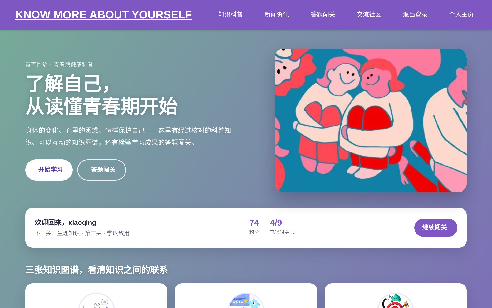
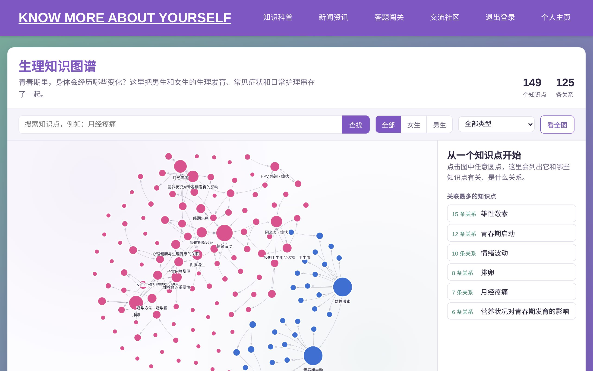
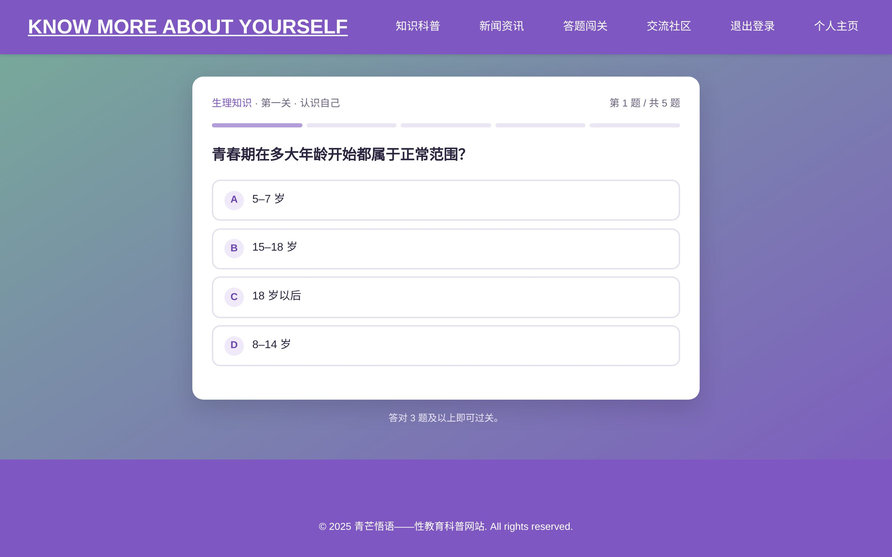
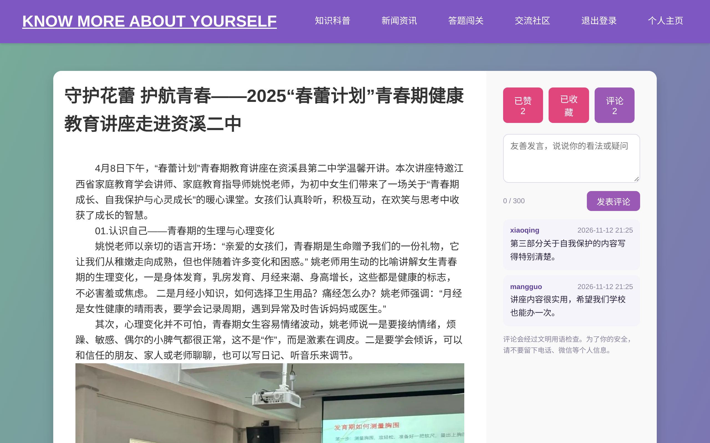
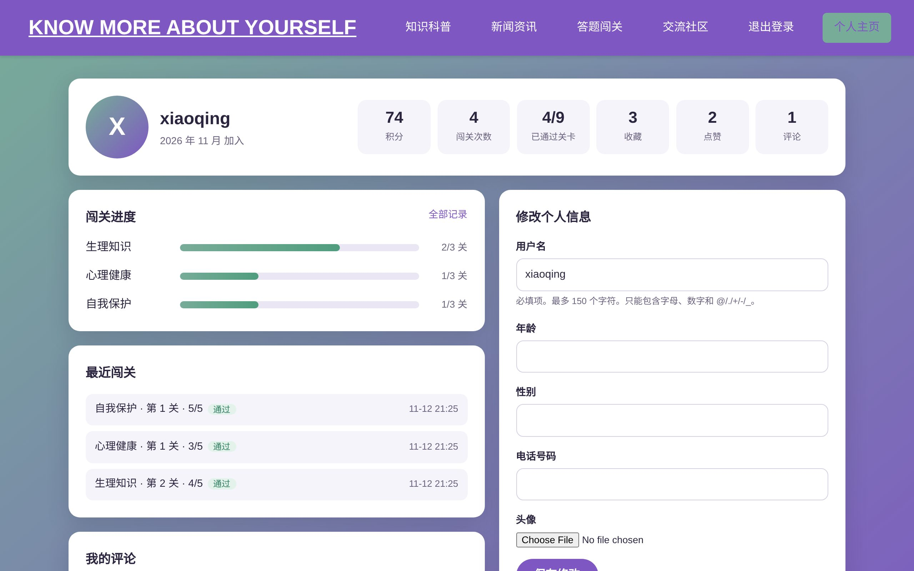

# Mangowit 青芒悟语

[](https://github.com/chagou313/mangowit/actions/workflows/tests.yml)


**English** | [中文](README.zh-CN.md)

A puberty and sexual-health education website for Chinese-speaking teenagers. It turns medically sourced information into interactive knowledge graphs, a quiz with progress tracking, and a moderated community.

**Live demo:** <https://mangowit.onrender.com>. It runs on a free plan, so the first visit after a quiet period takes about a minute to wake up.



## Features

- **Interactive knowledge graphs.** Three graphs cover physiology, mental health and self-protection, with 349 concepts and 321 relations in total. Readers can search them, filter by topic and gender, and click any concept to see how it connects to others. The data lives in plain JSON files, so the content can be edited without touching code.
- **Quiz with progress tracking.** 45 questions across 3 topics × 3 levels. Every question has an explanation, and many cite the sources they were checked against, such as the NHS, the WHO and Chinese law. Answer options are shuffled on every attempt, and answers are graded on the server so they never reach the browser early. Scores, passed levels and the full history are saved to the reader's profile.
- **Likes, favorites and comments.** These work on both news articles and community topics. Comments are filtered for abuse, spam and personal contact details (phone numbers, WeChat IDs and links), limited to 5 per minute per user, safely escaped, and can be hidden by an admin.
- **Personal dashboard.** Points, quiz progress per topic, recent attempts, favorites, likes and comments, plus profile and avatar editing.
- **Q&A assistant.** Answers common questions from a curated answer bank. Questions are normalised and fuzzy-matched, so rephrased questions still find the right answer.
- **News and law articles.** Real reports and excerpts from Chinese child-protection law.

| Knowledge graph | Quiz |
| --- | --- |
|  |  |
| **Article with likes, favorites and comments** | **Personal dashboard** |
|  |  |

## Tech stack

| Layer | Technology |
| --- | --- |
| Backend | Python 3.13, Django 5.2 |
| Frontend | Django templates, vanilla JavaScript, [vis-network](https://visjs.github.io/vis-network/) for the graphs |
| Database | SQLite locally, PostgreSQL ([Neon](https://neon.tech)) in production |
| Media storage | [Cloudinary](https://cloudinary.com) for user avatars |
| Hosting | [Render](https://render.com) with Gunicorn and WhiteNoise, defined in `render.yaml` |
| Testing / CI | Django test runner (72 tests) and GitHub Actions |

## Engineering highlights

- **The server is the source of truth.** Quiz grading, like and favorite toggles, and comment validation all happen in Django views. The browser only renders the result.
- **One interaction layer for every kind of content.** Likes, favorites and comments use a shared `target` key (e.g. `news2`, `topic-12`), so articles and community topics reuse the same models, endpoints and templates.
- **Security basics.** CSRF protection on every write, login-required JSON endpoints that return 401 instead of redirecting, open-redirect protection on login, escaped user content, and secrets kept in environment variables.
- **Configuration through the environment.** The same code runs on SQLite locally and on PostgreSQL with Cloudinary in production. Every push to `main` triggers a redeploy, and migrations run automatically on startup.

## Project structure

```text
mangowit/                 Project settings and URL routing
sex_education_app/        Users, home page, profile, login and registration
KnowledgePopularization/  Knowledge graphs and education videos
EducationInformation/     News and law articles, likes and favorites
challenge/                Quiz (question bank in question_bank.py)
CommunityForums/          Community topics
AI_communication/         Q&A assistant
interactions/             Comments and moderation
static/kg/                Knowledge-graph data (JSON) and renderer
tests/                    Automated tests
```

## Run locally

```bash
git clone https://github.com/chagou313/mangowit.git
cd mangowit
python3 -m venv .venv
.venv/bin/python -m pip install -r requirements.txt
.venv/bin/python manage.py migrate
.venv/bin/python manage.py seed_ai_data
.venv/bin/python manage.py runserver
```

Then open <http://127.0.0.1:8000/>. Run the tests with `.venv/bin/python manage.py test`.

## Deployment

The site is deployed on Render (see `render.yaml`), with Neon PostgreSQL for data and Cloudinary for avatars. Merging into `main` redeploys automatically. `DATABASE_URL` and `CLOUDINARY_URL` are set only in Render's Environment settings and are never committed.
