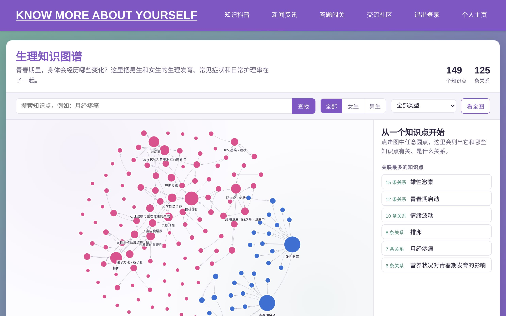
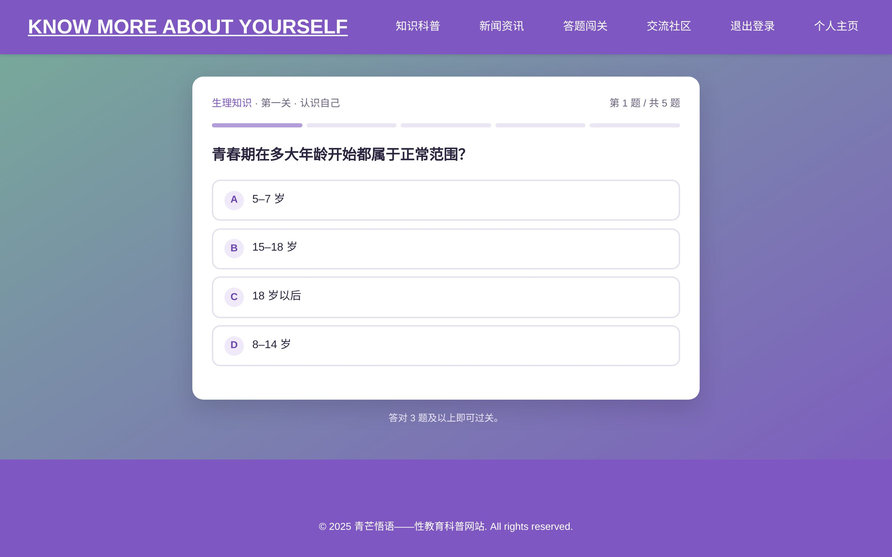
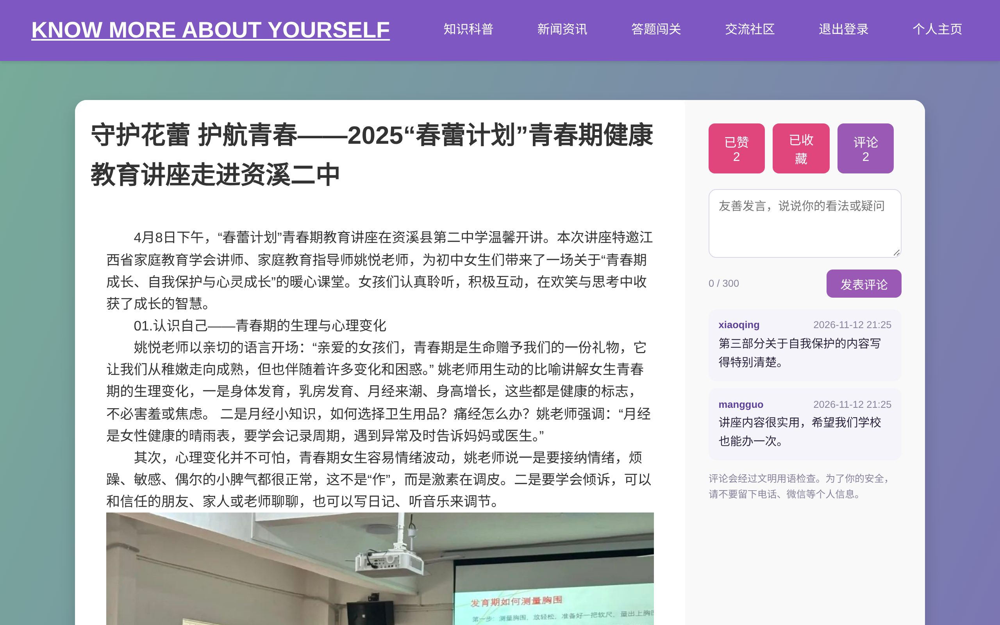
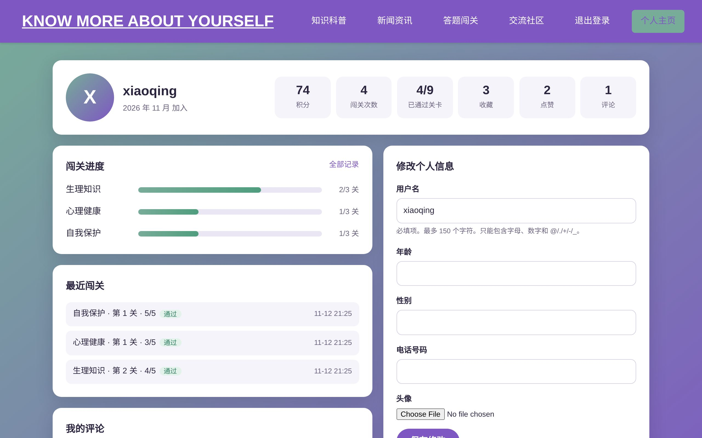

# 青芒悟语 Mangowit

[](https://github.com/chagou313/mangowit/actions/workflows/tests.yml)


[English](README.md) | **中文**

面向青少年的青春期健康科普网站。把有权威出处的知识做成可交互的知识图谱、能记录进度的答题闯关，以及有内容审核的交流社区。

**在线访问：<https://mangowit.onrender.com>**（免费服务，闲置后首次打开需要等待约一分钟）


## 功能

- **交互式知识图谱**：生理、心理、自我保护三张图谱，共 349 个知识点、321 条关系；支持搜索、按主题和性别筛选，点击任意知识点查看与其他知识点的关联。数据存放在 JSON 文件中，修改内容不用改代码。
- **答题闯关**：3 个主题 × 3 关，共 45 道题，每题附解析，多数题目注明核对出处（如 NHS、WHO、我国法律条文）。每次答题选项顺序随机打乱，由服务器判分，答案不会提前发到浏览器；成绩、通关进度和历史记录保存在个人主页。
- **点赞、收藏、评论**：新闻文章和社区话题都支持。评论会过滤辱骂、广告和联系方式（电话、微信、链接），每人每分钟最多 5 条，内容安全转义，管理员可隐藏评论。
- **个人主页**：积分、各主题闯关进度、最近闯关记录、收藏、点赞和评论，以及资料和头像修改。
- **问答助手**：基于整理好的问答库回答常见问题；问题经过标准化和模糊匹配，换种说法也能找到答案。
- **新闻与法规**：真实的新闻报道和未成年人保护相关法律条文。

| 知识图谱 | 答题闯关 |
| --- | --- |
|  |  |
| **文章页：点赞、收藏、评论** | **个人主页** |
|  |  |

## 技术栈

| 层 | 技术 |
| --- | --- |
| 后端 | Python 3.13、Django 5.2 |
| 前端 | Django 模板、原生 JavaScript、[vis-network](https://visjs.github.io/vis-network/)（知识图谱） |
| 数据库 | 本地 SQLite，线上 PostgreSQL（[Neon](https://neon.tech)） |
| 媒体存储 | [Cloudinary](https://cloudinary.com)（用户头像） |
| 部署 | [Render](https://render.com)，Gunicorn + WhiteNoise，配置见 `render.yaml` |
| 测试 / CI | Django 测试（72 个用例）+ GitHub Actions |

## 技术要点

- **以服务器为准**：答题判分、点赞收藏切换、评论校验都在 Django 视图中完成，浏览器只负责展示结果。
- **统一的互动层**：点赞、收藏、评论通过统一的 `target` 标识（如 `news2`、`topic-12`）关联内容，文章和社区话题共用同一套模型、接口和模板。
- **基础安全**：所有写操作有 CSRF 保护；需要登录的 JSON 接口返回 401 而不是跳转；登录跳转防止开放重定向；用户内容转义输出；密钥只放在环境变量里。
- **环境变量配置**：同一套代码本地用 SQLite，线上用 PostgreSQL + Cloudinary；推送到 `main` 自动重新部署，启动时自动执行数据库迁移。

## 目录结构

```text
mangowit/                 项目配置与 URL 路由
sex_education_app/        用户、首页、个人主页、登录注册
KnowledgePopularization/  知识图谱与科普视频
EducationInformation/     新闻法规文章、点赞收藏
challenge/                答题闯关（题库在 question_bank.py）
CommunityForums/          社区话题
AI_communication/         问答助手
interactions/             评论与内容审核
static/kg/                知识图谱数据（JSON）与渲染脚本
tests/                    自动化测试
```

## 本地运行

```bash
git clone https://github.com/chagou313/mangowit.git
cd mangowit
python3 -m venv .venv
.venv/bin/python -m pip install -r requirements.txt
.venv/bin/python manage.py migrate
.venv/bin/python manage.py seed_ai_data
.venv/bin/python manage.py runserver
```

浏览器打开 <http://127.0.0.1:8000/>。运行测试：`.venv/bin/python manage.py test`。

## 部署

网站部署在 Render（配置见 `render.yaml`），数据库用 Neon PostgreSQL，头像存放在 Cloudinary。合并到 `main` 分支后会自动重新部署。`DATABASE_URL`、`CLOUDINARY_URL` 只填在 Render 的 Environment 页面，不要提交到 GitHub。
